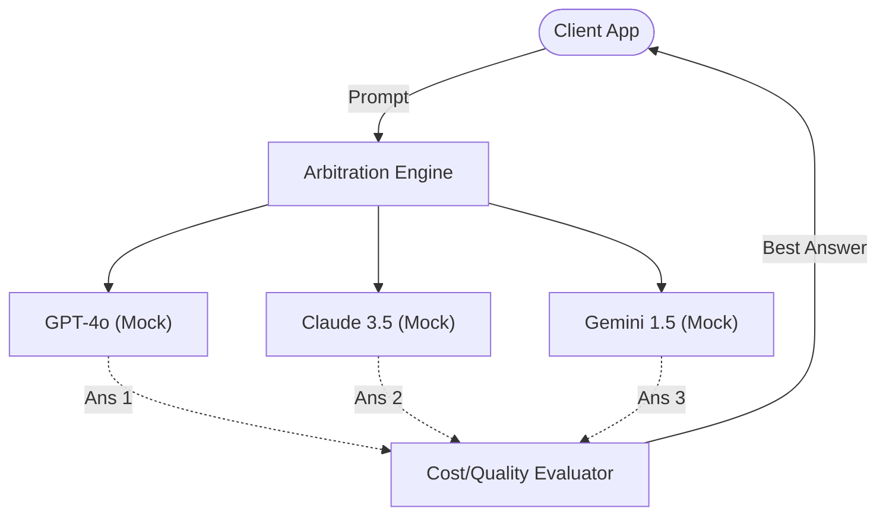
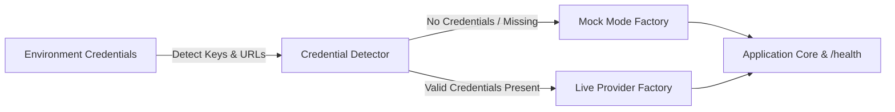

# Architecture — llm-output-arbitration
> Last updated: 2026-08-29 | Maturity: Partial Prototype
> _LLM consensus and arbitration engine._

## System Diagram

## Component Table
| Component | File | Responsibility | Tech |
|---|---|---|---|
| Arbitrator | `src/arbitrator/`| Manages parallel LLM calls | Python Asyncio |
| Evaluator | `src/evaluator/`| Scores answers on cost/speed/quality | Python |
| API | `server/`| REST Interface | FastAPI |

## Dependency Honesty Table
| Dependency | Status | Notes |
|---|---|---|
| Providers | **Mocked** | Currently uses static test fixtures for LLM responses to avoid API costs during evaluation. |

## Component Breakdown
- **Core Technology**: Python, LangGraph, Pydantic
- **Design Paradigm**: Emphasizes high availability, fault tolerance, and security.

## Progressive Credential Loading & Production Architecture (v0.2.0)

This service implements the **Progressive Credential Loading (PCL)** pattern, decoupling development speed from external infrastructure provisioning:

### Core Architecture Components
1. **Mode Detection Singleton:** Inspects environment configuration at boot time without hard crashes on missing secrets.
2. **Dual-Mode Factory Wrappers:**
   - **Storage / Cache:** In-process maps or SQLite `:memory:` transparently promote to managed Redis or PostgreSQL when connection strings are supplied.
   - **AI Providers:** Deterministic heuristic generators and local embeddings transparently promote to live OpenAI, Anthropic, or Gemini API clients.
3. **Hot-Reload & Dynamic TLS:** File watchers monitor mounted volume paths (Kubernetes ConfigMaps and Secrets) to update certificates and limit configs atomically without process restarts.
4. **Health & Observability:** The `/health` endpoint exposes real-time runtime mode metadata (`mock` vs `live`) across all backing adapters.
